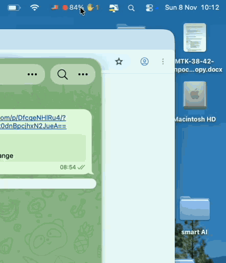

<p align="center"></p>

<p align="center"><b>Keep your Claude Code chats clean.</b><br>
A small, free macOS menu bar app for Claude Code in the Claude desktop app.</p>

<p align="center"><a href="https://github.com/trapastnik/cloudex-guard/releases/latest">Download</a> · <a href="#install">Install</a> · <a href="#your-keys-and-data-stay-yours">Privacy</a> · <a href="README.ru.md">Русский</a> · <a href="https://medfab-dev.tech/cloudex-guard/">Website</a></p>

<p align="center"><br><sub>Recorded in the app’s demo mode (<code>app/demo.sh</code>): made-up chats.</sub></p>

> Cloudex Guard is an independent open-source project. It is not made, endorsed or supported by Anthropic. Claude and Claude Code are trademarks of Anthropic.

## A full context window costs you twice

**The problem.** Every message re-reads the whole conversation, so a nearly full chat burns your limits much faster than a fresh one. The model gets slower and loses details from the beginning, and auto-compaction kicks in at an arbitrary moment, squeezing the dialog into a summary — decisions, file paths and open questions get lost.

**The fix: save, hand off, clear, continue.**
1. **See it coming** — every chat's fill in the menu bar.
2. **🧹 Save everything** — one click asks the chat to write all its state to the project docs.
3. **Hand off** — the chat writes a detailed handoff and a short text to paste back.
4. **Clear and keep going in the same chat** — `/clear`, paste the short text: the chat picks up from the docs with a clean context.

Steps 2–3 are one click; step 4 stays with you on purpose. Clearing can't be undone, so you glance at the handoff first — if a decision or a next step is missing, you ask before it's gone. Cloudex Guard never clears a chat by itself. Step by step, with screens: https://medfab-dev.tech/cloudex-guard/#clear

Nothing is lost: the knowledge lives in the docs, not in the context window. Fewer tokens per message, no surprise compaction.

What the app gives you for this:

- **Context at a glance** — a colored dot and the fullest chat's percentage in the menu bar; every chat sorted by fill in the menu, with tokens, group and time of the last reply. Click a row to open the chat.
- **Waiting for you** — ✋ chats blocked on your permission or answer, 💬 chats that just finished their turn. Shown only when someone is waiting.
- **Handoff before clearing (🧹)** — one click asks a chat to save everything to the project docs and write a detailed handoff and a short text to paste back after clearing. Always asks you to confirm first.
- **Recent chats** and **plan limits** — 5-hour and weekly limits with reset times; in the menu bar only above 80%.

Cloudex Guard does this one thing and makes no network requests at all. The interface is English, or Russian on a Russian system.

## Install

You need macOS 13 or later and the Claude desktop app.

### The usual way: download and drag

1. **Download** [`CloudexGuard.dmg`](https://github.com/trapastnik/cloudex-guard/releases/latest/download/CloudexGuard.dmg).
2. **Open it and drag** Cloudex Guard onto the Applications folder.
3. **Open Cloudex Guard.** The first time, macOS says it can't check the developer. That's expected for free apps distributed outside the App Store without a paid Apple developer certificate — it doesn't mean anything is wrong. To allow it once:
   - open **System Settings → Privacy & Security**,
   - scroll down to the message about Cloudex Guard and click **Open Anyway**,
   - confirm. macOS remembers the choice; you won't be asked again.
4. **Click Connect** when Cloudex Guard offers to connect to Claude Code. It installs its small mod, adds one line to `~/.claude/settings.json` (keeping a copy of the original) and starts at login.
5. **Restart the Claude app.** Each chat appears in the menu after its next reply.

Changed your mind? Quit it from the menu and run the uninstall command below — it removes everything, including the line in `settings.json`.

### One command in Terminal

No dialogs, nothing to approve in System Settings:

```bash
curl -fsSL https://raw.githubusercontent.com/trapastnik/cloudex-guard/main/install.sh | sh
```

It downloads the latest release, checks its SHA-256, installs the app and the mod, **asks** before touching `~/.claude/settings.json` (keeping a backup) and starts Cloudex Guard at login. [Read the script](install.sh) first if you like. To remove everything:

```bash
curl -fsSL https://raw.githubusercontent.com/trapastnik/cloudex-guard/main/install.sh | sh -s uninstall
```

### From source

```bash
git clone https://github.com/trapastnik/cloudex-guard.git && cd cloudex-guard
./app/build.sh        # needs Xcode Command Line Tools: xcode-select --install
```

Then choose **Connect to Claude Code…** in the menu.

## Your keys and data stay yours

**What Cloudex Guard never touches:** your API keys and tokens, your Claude account and login, your passwords and Keychain, the contents of your chats and transcripts, your files and projects.

**What it asks macOS for:** nothing. No Accessibility, Full Disk Access, Screen Recording, Keychain or Location permission — you will never see such a prompt from it.

**What it does see:** the mod receives from Claude Code only numbers and labels about each chat — how full its context is, plan limits, whether it's busy or waiting for you, its title, sidebar group, folder and link — and writes them to `~/.claude/cloudex-guard` on your Mac. The only thing it asks for is the chat's title and link, from the Claude app itself on your Mac. The menu bar app reads those files and nothing else. Files of chats that have been silent for more than 60 days are deleted from that folder at launch. No analytics, no telemetry, no server of ours.

### Don't take our word for it

There is no paid audit of this project, but everything above can be checked independently:

1. **Read the code.** It is all here — about 760 lines of Swift for the app and a single file of about 300 lines for the mod.
2. **Check where the file came from — or skip it entirely.** Since 1.1.1, releases are built by GitHub Actions from this repository's code, and GitHub signs a provenance attestation for every file. One command proves your download was built from this source: `gh attestation verify CloudexGuard.dmg --repo trapastnik/cloudex-guard`. You can also compare its SHA-256 with `SHA256SUMS.txt` (`shasum -a 256 CloudexGuard.dmg`). If you'd rather not trust a binary at all, build the app from this source yourself — it takes a minute (see *From source*).
3. **Watch the network.** Run a firewall that shows every connection, such as the free open-source [LuLu](https://objective-see.org/products/lulu.html) by Objective-See or [Little Snitch](https://www.obdev.at/products/littlesnitch/). You'll see no connections from Cloudex Guard at all.
4. **Check what the mod can do.** Claude Code itself lists every engine call and event a mod uses: `claude plugin validate ~/.claude/mods/cloudex-guard` — you'll see file writes, timers, the usage numbers and one call to the Claude app's own session service (`ccd_session_mgmt`, for the chat title and link), and no network access.
5. **Scan the file.** Upload the DMG to [VirusTotal](https://www.virustotal.com) to check it with about 70 antivirus engines, or compare its SHA-256 with `SHA256SUMS.txt` in the release.

## No network requests at all

Neither the menu bar app nor the mod goes online. There is no update check, no IP lookup, no analytics. Everything stays in `~/.claude/cloudex-guard` on your Mac.

A web address opens only when you click a link in the menu — **Also from us: Cloudex Shield** or **Support Cloudex Guard** — and then it opens in your browser, not in the app. Clicking a chat opens it in the Claude app.

To check it yourself, run [LuLu](https://objective-see.org/products/lulu.html) or [Little Snitch](https://www.obdev.at/products/littlesnitch/) and use the app for a while: no connection from `CloudexGuard` will ever show up. You can also block it there completely — nothing changes in how it works.

Until 1.1, Cloudex Guard also had a network guard that checked your public IP. It now lives in a separate app, [Cloudex Shield](#sibling-app-cloudex-shield). If you used it and Cloudex Shield isn't installed yet, Cloudex Guard 1.2 shows a one-time notice with a link.

## Troubleshooting

- **The icon is gone.** macOS hides menu bar icons that don't fit (behind the camera notch). Check it runs: `pgrep -lx CloudexGuard`. If it does, ⌘-drag it to the right or free some space.
- **A chat doesn't appear.** It shows up after its next reply; chats that haven't run since you restarted Claude are asleep.

## Sibling app: Cloudex Shield

[Cloudex Shield](https://github.com/trapastnik/cloudex-shield) is a separate free menu bar app from the same author: a per-app kill switch for when your VPN drops, reconnects or switches servers, or Wi-Fi changes. It shows the country your Mac goes out from and pauses the apps you choose until the address is the one you expect, then resumes them exactly where they stopped. It is not a VPN and doesn't change your traffic. It is the network guard that used to be part of Cloudex Guard 1.1; your settings carry over. Website: https://medfab-dev.tech/cloudex-shield/

## Support

Cloudex Guard is free. If it saves you time, you can support its development:

- **Bitcoin (BTC):** `1JZ3neiNzLC5kiGAer5UQGQvK9xSJqnc87`
- **Ethereum (ETH):** `0x2f507c67655ddf3638c83238c71d51defe7b1fec`
- **USDT (Tether), ERC-20 on the Ethereum network only:** `0x2f507c67655ddf3638c83238c71d51defe7b1fec`

Please double-check the network: tokens sent through other networks (BNB Chain, Tron and so on) can be lost. Stars, bug reports and ideas in [Issues](https://github.com/trapastnik/cloudex-guard/issues) help too.

## License

MIT — see [LICENSE](LICENSE).
