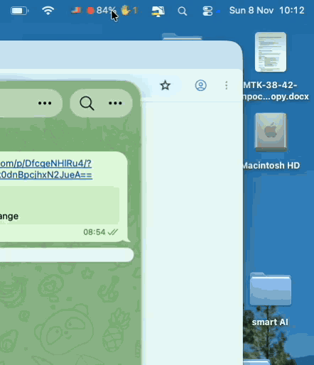

<p align="center"></p>

<p align="center"><b>Порядок в чатах Claude Code.</b><br>
Небольшое бесплатное приложение для строки меню macOS к Claude Code в десктопном приложении Claude.</p>

<p align="center"><a href="https://github.com/trapastnik/cloudex-guard/releases/latest">Скачать</a> · <a href="#установка">Установка</a> · <a href="#ваши-ключи-и-данные-остаются-вашими">Приватность</a> · <a href="README.md">English</a> · <a href="https://medfab-dev.tech/ru/cloudex-guard/">Сайт</a></p>

<p align="center"><br><sub>Записано в демо-режиме приложения (<code>app/demo.sh</code>): выдуманные чаты.</sub></p>

> Cloudex Guard — независимый проект с открытым кодом. Anthropic его не делала, не одобряла и не поддерживает. Claude и Claude Code — товарные знаки Anthropic.

## Переполненный контекст обходится дважды

**Проблема.** Каждое сообщение заново читает весь диалог, поэтому почти полный чат расходует лимиты намного быстрее свежего. Модель отвечает медленнее и теряет детали из начала разговора, а автоматическое сжатие срабатывает в случайный момент и превращает диалог в пересказ — решения, пути к файлам и открытые вопросы теряются.

**Решение: сохранить, передать, очистить, продолжить.**
1. **Видно заранее** — заполнение каждого чата в строке меню.
2. **🧹 Сохранить всё** — одна кнопка просит чат записать всё состояние в документацию проекта.
3. **Передать** — чат пишет подробный handoff и короткий текст для вставки.
4. **Очистить и продолжить в том же чате** — `/clear`, вставить короткий текст: чат продолжает по документации с чистым контекстом.

Шаги 2–3 — одна кнопка, шаг 4 сознательно остаётся за вами. Очистку не отменить, поэтому сначала стоит взглянуть на handoff: если там не хватает решения или следующего шага — спросить, пока чат ещё помнит. Сам Cloudex Guard чат никогда не очищает. По шагам, с макетами экранов: https://medfab-dev.tech/ru/cloudex-guard/#clear

Ничего не теряется: знания живут в документации, а не в окне контекста. Меньше токенов на сообщение, никаких внезапных сжатий.

Что для этого есть в приложении:

- **Контекст с одного взгляда** — цветная точка и процент самого заполненного чата в строке меню; в меню все чаты по заполненности, с токенами, группой и временем последнего ответа. Клик открывает чат.
- **«Ждут вас»** — ✋ чаты, которые ждут вашего разрешения или ответа, 💬 чаты, которые только что закончили ход. Раздел появляется, только когда кто-то ждёт.
- **Handoff перед очисткой (🧹)** — одна кнопка просит чат сохранить всё в документации, написать подробный handoff и короткий текст для вставки после очистки. Всегда сначала спрашивает подтверждение.
- **Последние чаты** и **лимиты** — на 5 часов и неделю, со временем сброса; в строке меню — только выше 80%.

Cloudex Guard делает только это и в сеть не обращается вообще. Интерфейс — на английском или на русском, если система на русском.

## Установка

Нужны macOS 13 или новее и десктопное приложение Claude.

### Обычный способ: скачать и перетащить

1. **Скачайте** [`CloudexGuard.dmg`](https://github.com/trapastnik/cloudex-guard/releases/latest/download/CloudexGuard.dmg).
2. **Откройте его и перетащите** Cloudex Guard в папку «Программы».
3. **Откройте Cloudex Guard.** В первый раз macOS скажет, что не может проверить разработчика. Это нормально для бесплатных программ, которые распространяются не через App Store и без платного сертификата разработчика Apple, — это не значит, что с программой что-то не так. Чтобы разрешить её один раз:
   - откройте **Системные настройки → Конфиденциальность и безопасность**,
   - прокрутите вниз до сообщения о Cloudex Guard и нажмите **«Всё равно открыть»**,
   - подтвердите. macOS запомнит выбор и больше спрашивать не будет.
4. **Нажмите «Подключить»**, когда Cloudex Guard предложит подключиться к Claude Code. Он поставит свой небольшой мод, добавит одну строку в `~/.claude/settings.json` (сохранив копию исходного файла) и будет запускаться при входе в систему.
5. **Перезапустите приложение Claude.** Каждый чат появится в меню после своего следующего ответа.

Передумали? Выйдите через меню и выполните команду удаления ниже — она уберёт всё, включая строку в `settings.json`.

### Одной командой в Терминале

Без диалогов и подтверждений в Системных настройках:

```bash
curl -fsSL https://raw.githubusercontent.com/trapastnik/cloudex-guard/main/install.sh | sh
```

Скрипт скачает последний релиз, сверит SHA-256, поставит приложение и мод, **спросит**, прежде чем трогать `~/.claude/settings.json` (сохранив копию), и включит запуск при входе. [Скрипт можно прочитать](install.sh) перед запуском. Удалить всё:

```bash
curl -fsSL https://raw.githubusercontent.com/trapastnik/cloudex-guard/main/install.sh | sh -s uninstall
```

### Из исходников

```bash
git clone https://github.com/trapastnik/cloudex-guard.git && cd cloudex-guard
./app/build.sh        # нужны Command Line Tools: xcode-select --install
```

Затем в меню — **«Подключить к Claude Code…»**.

## Ваши ключи и данные остаются вашими

**Чего Cloudex Guard не касается никогда:** ваших API-ключей и токенов, аккаунта и входа в Claude, паролей и Связки ключей, содержимого чатов и их истории, ваших файлов и проектов.

**Каких разрешений просит у macOS:** никаких. Ни универсального доступа, ни полного доступа к диску, ни записи экрана, ни Связки ключей, ни геопозиции — таких запросов от него вы не увидите.

**Что он видит:** мод получает от Claude Code только цифры и подписи о каждом чате — насколько заполнен контекст, лимиты, работает ли чат или ждёт вас, его название, группу, папку и ссылку — и записывает их в `~/.claude/cloudex-guard` на вашем Маке. Название и ссылку чата он спрашивает у самого приложения Claude на вашем Маке — больше ни у кого. Приложение в строке меню читает эти файлы, и только их. Файлы чатов, которые молчат больше 60 дней, при запуске удаляются из этой папки. Ни аналитики, ни телеметрии, ни нашего сервера.

### Не верьте на слово — проверьте

Платного аудита у проекта нет, но всё сказанное выше можно проверить независимо:

1. **Прочитайте код.** Он весь здесь — около 760 строк Swift у приложения и один файл примерно на 300 строк у мода.
2. **Проверьте, откуда файл, — или обойдитесь без него.** С версии 1.1.1 релизы собирает GitHub Actions из кода этого репозитория, и GitHub подписывает подтверждение происхождения для каждого файла. Одна команда докажет, что ваш файл собран именно из этого кода: `gh attestation verify CloudexGuard.dmg --repo trapastnik/cloudex-guard`. Можно и сверить SHA-256 с `SHA256SUMS.txt` (`shasum -a 256 CloudexGuard.dmg`). Если не хотите доверять готовому файлу вовсе, соберите приложение из этого кода сами — это минута (см. «Из исходников»).
3. **Посмотрите на сеть.** Включите файрвол, который показывает каждое соединение, — например, бесплатный открытый [LuLu](https://objective-see.org/products/lulu.html) от Objective-See или [Little Snitch](https://www.obdev.at/products/littlesnitch/). Ни одного соединения от Cloudex Guard вы там не увидите.
4. **Проверьте, что может мод.** Claude Code сам перечисляет все вызовы и события, которые использует мод: `claude plugin validate ~/.claude/mods/cloudex-guard` — там будут запись файлов, таймеры, цифры расхода и один вызов собственного сервиса приложения Claude (`ccd_session_mgmt`, за названием и ссылкой чата), и никакого доступа в сеть.
5. **Проверьте файл антивирусами.** Загрузите DMG на [VirusTotal](https://www.virustotal.com) — его проверят около 70 антивирусов, — или сверьте его SHA-256 с `SHA256SUMS.txt` в релизе.

## В сеть — ничего

Ни приложение в строке меню, ни мод в сеть не выходят. Нет проверки обновлений, нет определения IP, нет аналитики. Всё остаётся в `~/.claude/cloudex-guard` на вашем Маке.

Веб-адрес открывается, только когда вы сами нажимаете ссылку в меню — **«Ещё от нас: Cloudex Shield»** или **«Поддержать Cloudex Guard»**, — и открывается он в браузере, а не в приложении. Клик по чату открывает его в приложении Claude.

Чтобы проверить, включите [LuLu](https://objective-see.org/products/lulu.html) или [Little Snitch](https://www.obdev.at/products/littlesnitch/) и поработайте как обычно: соединений от `CloudexGuard` там не появится. Можно и вовсе запретить ему сеть — работать он будет так же.

До версии 1.1 в Cloudex Guard был ещё страж сети, который проверял ваш внешний IP. Теперь это отдельное приложение — [Cloudex Shield](#соседнее-приложение-cloudex-shield). Если вы им пользовались, а Cloudex Shield ещё не установлен, Cloudex Guard 1.2 один раз покажет об этом сообщение со ссылкой.

## Если что-то не так

- **Пропал значок.** macOS прячет значки, которым не хватает места (под вырезом камеры). Проверьте, что приложение работает: `pgrep -lx CloudexGuard`. Если да — перетащите значок правее с зажатым ⌘ или освободите место.
- **Чата нет в списке.** Он появится после своего следующего ответа; чаты, которые не запускались после перезапуска Claude, спят.

## Соседнее приложение: Cloudex Shield

[Cloudex Shield](https://github.com/trapastnik/cloudex-shield) — отдельное бесплатное приложение для строки меню от того же автора: kill switch для отдельных программ на случай, когда VPN отвалился, переподключился или сменил сервер, или сменился Wi-Fi. Оно показывает страну, из которой выходит ваш Мак, и ставит выбранные программы на паузу, пока адрес не станет тем, которого вы ждёте, а потом они продолжают с того же места. Это не VPN, трафик оно не меняет. Это тот самый страж сети, который раньше был частью Cloudex Guard 1.1; настройки переходят сами. Сайт: https://medfab-dev.tech/ru/cloudex-shield/

## Поддержать

Cloudex Guard бесплатен. Если он экономит вам время, можно поддержать разработку:

- **Bitcoin (BTC):** `1JZ3neiNzLC5kiGAer5UQGQvK9xSJqnc87`
- **Ethereum (ETH):** `0x2f507c67655ddf3638c83238c71d51defe7b1fec`
- **USDT (Tether), только ERC-20 в сети Ethereum:** `0x2f507c67655ddf3638c83238c71d51defe7b1fec`

Проверьте сеть перед отправкой: токены, отправленные через другие сети (BNB Chain, Tron и т. п.), могут потеряться. Звёзды, сообщения об ошибках и идеи в [Issues](https://github.com/trapastnik/cloudex-guard/issues) тоже помогают.

## Лицензия

MIT — см. [LICENSE](LICENSE).
